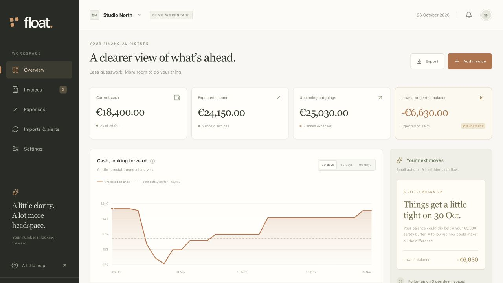

# Float

Float forecasts daily cash balances and shows which overdue invoices would most improve the lowest projected balance if collected today.



## Run the app

Clone this repository, then run the commands from its root.

```sh
git clone https://github.com/Koquda/float.git
cd float
```

1. Install Node.js 22.13 or newer.
2. Run `npm ci`.
3. Run `npm run build`.
4. Apply the local database migration.

```sh
node --import ./scripts/sites-env.mjs ./node_modules/wrangler/bin/wrangler.js d1 execute DB --local --config dist/server/wrangler.json --persist-to .wrangler/state --file drizzle/0000_abandoned_nemesis.sql
```

5. Run `npm run dev`.
6. Open the printed local URL. Use the sign-in link to enter the local test workspace.

Hosted sign-in and private access use the Sites platform. Local sign-in is a development simulation and is absent from production builds.

## Use your data

The first workspace contains labeled sample invoices and expenses. Set your current cash balance in Settings. Add invoices and expenses, or import a CSV under Imports & alerts. Current cash needs manual reconciliation. This release does not connect to a bank or automatically reconcile historic expenses.

CSV amounts use decimal euros. Keep invoice IDs stable between imports.

```csv
id,client,description,amount,due_date,expected_date,status
acme-001,Acme,Design retainer,2400.00,2026-11-01,2026-11-05,open
```

`expected_date` and `status` are optional. Status accepts `open` or `paid`. CSV files support quoted fields and contain at most 2,000 invoices and 1 MB. The ledger supports 5,000 invoices. Failed validation rejects the whole file. Existing paid invoices stay paid. Exported invoices can be reimported without duplication.

Marking an invoice paid increases current cash once. An existing open invoice that changes to paid in an import also increases cash once. A newly imported historical paid invoice does not change current cash. Monthly expenses recur on their original calendar day, with shorter months clamped to their final day.

The forecast uses one currency, EUR, with integer cents. Overdue receipts whose expected date has passed move to seven days from today. Scenarios delay expected receipts without changing the saved ledger. Past expenses do not appear as future outflows. Keep the balance and outstanding expenses current.

## Activate scheduled imports and alerts

The app has a protected serverless job endpoint and an hourly GitHub Actions workflow. Saving an import hour does not activate a scheduler. No external source, webhook, or scheduler is connected in the initial workspace.

1. Configure a CSV source in Settings. Supported hosts are `raw.githubusercontent.com` and `docs.google.com`. Use a direct CSV URL that returns a successful response without redirects. Verify it with **Sync now**.
2. Configure a Slack, Zapier, or Discord webhook in Settings to receive alerts. Webhook URLs are credentials. Keep the Site private and do not share exported settings.
3. Configure `FLOAT_JOB_TOKEN` and `FLOAT_OWNER_ID` as hosted runtime environment variables. The owner ID must match the authenticated Site user ID for the ledger. The job token must be a long random secret.
4. Use `.github/workflows/float-import.yml` in your own repository.
5. Add GitHub Actions secrets `FLOAT_SITE_URL`, `FLOAT_JOB_TOKEN`, and `FLOAT_SITES_ACCESS_TOKEN`. Obtain a Site service-access token through the supported Sites workflow. Never commit these values.
6. Set the GitHub Actions repository variable `FLOAT_SCHEDULE_ENABLED` to `true` after configuring those secrets. Scheduled jobs stay disabled until this variable is set.
7. Run **Float scheduled imports** manually in GitHub Actions. Check the app's import history and alert delivery history before relying on scheduled runs.

The workflow calls `/api/jobs` hourly at minute 15 UTC. The job imports once daily after the configured UTC hour and catches up on later runs. A successful daily import prevents duplicates. Concurrent connected imports share a lease. A newer uploaded CSV supersedes older in-flight data.

Alerts use a 60-day forecast and trigger when the forecast first falls below the cash buffer. They reset after recovery. Delivery uses a stable event ID with at-least-once semantics, a two-minute delivery lease, and at most five attempts. Failures retry after exponential delays when the job runs. A successful HTTP response marks delivery complete. A receiver should deduplicate by event ID.

## Verify changes

Run `npm test`, `npx tsc --noEmit`, and `npm run build`.

With the local preview running and the untouched sample ledger loaded, run `npm run test:api`. This test changes local sample data and restores the demo afterward. It refuses hosted URLs.

The checks cover cents and dates, monthly recurrence, collection priorities, paid-once behavior, export roundtrips, CSV validation and replay, import overlap, daily catch-up, alert retry behavior, and real local D1 concurrent writes. Outbound sources and webhook responses are simulated in service tests. Real third-party imports, webhook delivery, and an unattended hosted run require configuration and verification.

## Code ownership

`lib/float` owns the domain, forecast, import service, and versioned D1 repository. `app/api` authenticates and validates requests. `app/page.tsx` renders the workspace and calls the server forecast. `db/schema.ts` and `drizzle` own the database schema. `scripts/run-float-job.mjs` calls the protected job endpoint without printing credentials or financial data.

## Deployment

The app targets Cloudflare Workers and D1 through the included Vinext and Sites integration. `.openai/hosting.json` declares the database binding without a personal Site ID. Create a new Site for your deployment and bind its ID through the Sites workflow. Production authentication relies on Sites-provided identity headers. A bare Worker deployment needs its own authenticated gateway and must not trust client-supplied identity headers.

Local previews simulate sign-in only on loopback addresses. A public source repository does not make the hosted financial workspace public.

## Contributing

Read [CONTRIBUTING.md](CONTRIBUTING.md) for the development checks and [SECURITY.md](SECURITY.md) for vulnerability reporting.

## License

Float is available under the [MIT license](LICENSE). Vendored third-party code retains its original copyright notices. See [THIRD_PARTY_NOTICES.md](THIRD_PARTY_NOTICES.md).
